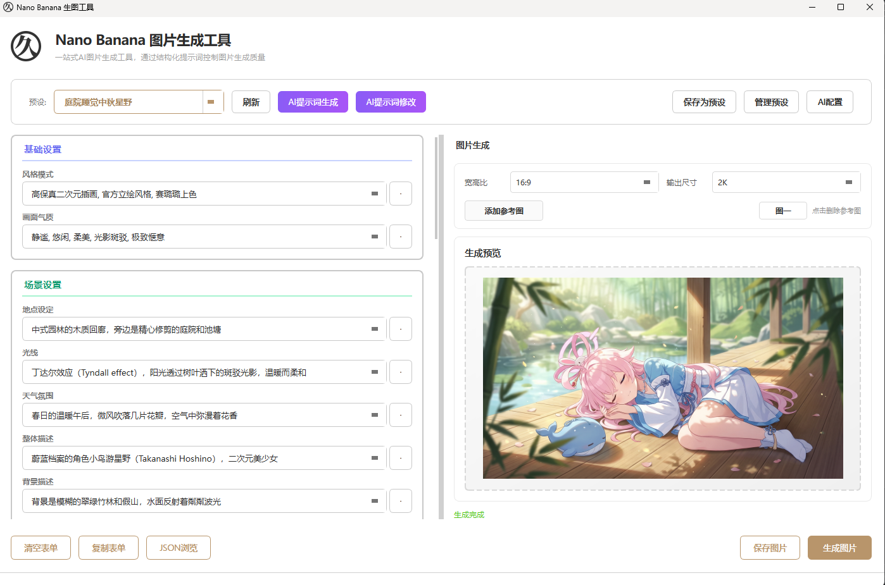
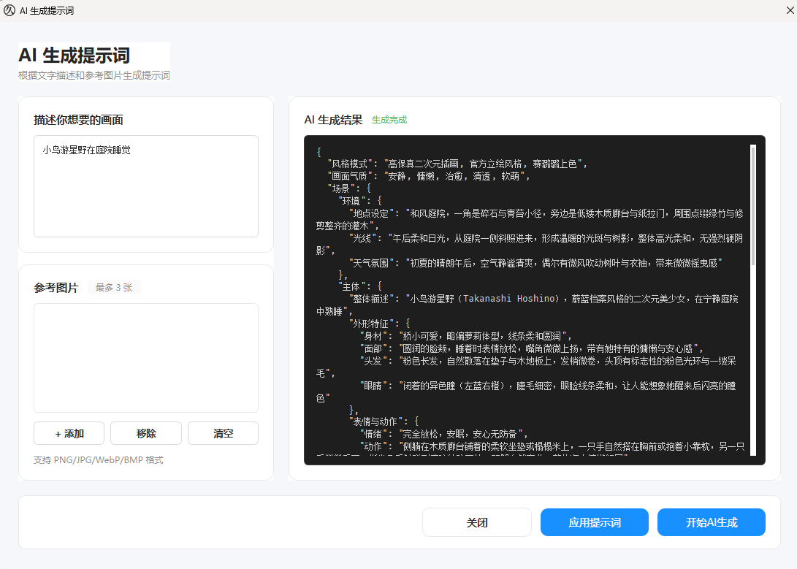
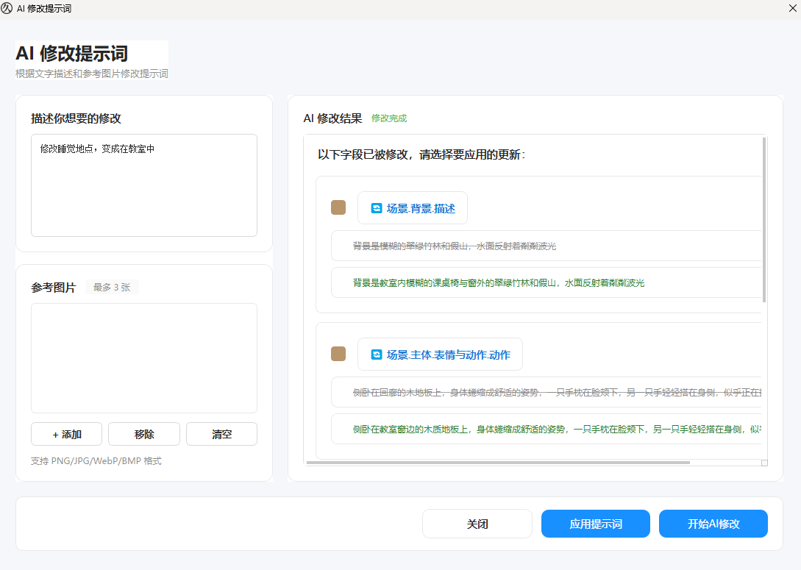
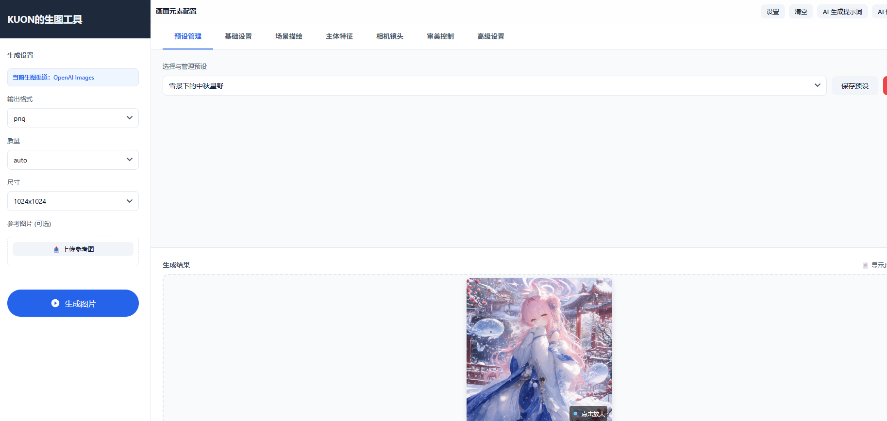

<p align="center">
  
</p>

<h1 align="center">Nano Banana Studio</h1>

<p align="center">
  <strong>一站式 AI 生图工作台，通过结构化提示词控制多渠道图片生成质量。</strong>
</p>

<p align="center">
  
  
  
  
  
  
</p>

---

## 1 功能特性

- **可视化编辑** - 表单化编辑提示词，方便针对特定元素进行修改。
- **AI 智能生成** - 一句话描述生成完整结构化提示词
- **AI 修改** - 一句话描述对已有提示词进行修改
- **预设管理** - 保存/加载/删除常用提示词配置
- **一键复制** - 复制最终发给模型的提示词（JSON 或线稿文本，与预览一致）
- **图片生成** - 支持 Gemini、OpenAI Images（gpt-image-2）、千问和豆包 Seedream 的多渠道生成图片，各渠道独立参数配置。

## 2 界面预览

* 主界面

----

* AI生成提示词界面

----

* AI修改提示词界面

----

* web界面

----


## 3 快速开始

### 3.1 下载客户端使用

在[Releases](https://github.com/lissettecarlr/nano-banana-prompt-studio/releases)页面下载最新客户端，目前只编译了`windows`版本，解压后双击运行。


### 3.2 web运行

```bash
pip install -e ".[web]"
python -m nano_banana.web        # 或 nano-banana-web，默认 http://localhost:5000
python -m nano_banana.web --open # 启动后自动打开浏览器

# Hub 上的 v0.4.1 是重构前的镜像，不包含当前代码。测这次重构请在项目根目录本地构建：
docker build -f web_dockerfile -t nano-banana-web .
docker run --rm --name nano-banana-web -p 5000:5000 -v nano-banana-data:/data nano-banana-web
```

Web 端的运行参数全部走环境变量：

| 环境变量 | 默认值 | 说明 |
| --- | --- | --- |
| `NANO_BANANA_HOME` | 源码运行：`<仓库>/data`；pip 安装：`~/.nano-banana`；镜像：`/data` | 可写数据目录（`config/ai_config.yaml`、`config/options.yaml`、`presets/`），桌面端同样生效 |
| `NANO_BANANA_HOST` | `127.0.0.1` | 监听地址。局域网 / 容器访问设为 `0.0.0.0`（镜像里已设置） |
| `NANO_BANANA_PORT` | `5000` | 监听端口 |
| `NANO_BANANA_DEBUG` | 关 | 设为 `1` 开启 Flask debug，**不要在对外监听时开启** |
| `NANO_BANANA_CORS_ORIGINS` | 空（不开放跨域） | 允许跨域访问 `/api` 的来源，逗号分隔；`*` 表示全部 |

> Web 端没有登录鉴权，API Key 保存在服务端。对外监听（`0.0.0.0`）时请放在可信网络或反向代理之后。

### 3.3 通过代码运行

#### 环境要求

- Python 3.10+

#### 安装

```bash
# 克隆仓库
git clone https://github.com/lissettecarlr/nano-banana-prompt-studio.git
cd nano-banana-prompt-studio

# 安装
pip install -e ".[desktop]"

# 运行桌面端
python -m nano_banana            # 或 nano-banana
```

源码运行时，配置和预设保存在仓库根目录的 `data/`（已加入 `.gitignore`）。
重构前留在 `src/config`、`src/presets` 下的旧数据会在首次启动时自动导入一次；
客户端（打包版）的数据仍在 exe 同级的 `config/`、`presets/`，覆盖升级不会丢失。

#### 打包

```bash
pip install -e ".[desktop,build]"
python build.py
```

### 3.4 在代码里直接使用核心（无界面）

核心不依赖 PyQt / Flask，可以直接嵌进脚本、CLI 或其他宿主（插件）：

```python
from nano_banana.core import ImageRequest, Studio, StudioPaths

studio = Studio(StudioPaths(user="./my-data"))        # 数据目录由调用方决定
studio.settings.update({"image": {"providers": {"doubao_image": {"api_key": "..."}}}})

document = studio.presets.load("某个预设") or {}
rendered = studio.render(document)                    # 文档 → 最终发给生图模型的文本
result = studio.generate_image(
    ImageRequest(prompt=rendered.text, provider="doubao_image", options={"aspect_ratio": "16:9"})
)
result.image.save("out.png")

# AI 生成 / 修改提示词是事件流：started → thinking → content* → result | error
for event in studio.generate_prompt("雨夜霓虹街道上撑伞的少女"):
    if event.type == "result":
        document = event.document
```

## 4 使用说明

### 4.1 基础使用

1. 启动应用后，点击设置按钮，填入模型
2. 选择一个预设提示词
3. 指定图片的尺寸大小等，点击图片生成
4. 等待图片生成，尺寸越大越耗时

### 4.2 AI提示词生成

如果在设置中配置了`提示词生成模型`，那么可以通过描述，让AI来生成提示词。点击`AI生成提示词`进入子页面，可以输入描述和传入图片，来生成。点击「应用到表单」将生成的内容填充到编辑器。

### 4.3 AI提示词修改

如果在设置中配置了`提示词生成模型`，那么可以通过描述，让AI来对当前的提示词进行修改，点击`AI修改提示词`进入子页面，可以输入描述和传入图片，来修改，界面会展示出具体修改了哪些项，点击「应用到表单」将生成的内容填充到编辑器。

## 5 架构与开发

```
src/nano_banana/
├── core/                 无 UI 依赖的领域核心
│   ├── studio.py         Studio：组合根 + 用例门面，交互口唯一的入口
│   ├── prompt/           结构化提示词：schema.yaml、文档读写、渲染、旧格式迁移、AI 输出解析、diff
│   ├── llm/              OpenAI-compatible 流式对话 + 系统提示词
│   ├── images/           生图渠道：ProviderSpec 声明 + 注册表 + providers/ 下每个渠道一个文件
│   ├── storage/          数据目录约定、配置 / 预设 / 选项存储、旧数据导入
│   └── media.py          参考图读取（本地路径 / data URL / 远程 URL）
├── builtin/              随包发布的只读数据：默认选项、内置预设
├── desktop/              交互口：PyQt6 客户端
└── web/                  交互口：Flask API + 静态前端
```

**依赖规则**（由 `lint-imports` 和 `tests/test_architecture.py` 强制，越界 CI 直接失败）：

- 交互口（`desktop`、`web`，以及以后的 CLI / 插件）只能导入 `nano_banana.core` 的顶层导出和
  `nano_banana.core.prompt`，彼此之间不能互相导入；
- `core` 不导入任何 UI / Web 框架；内部分层 `studio → storage | llm → images → prompt | media`；
- 渠道 SDK（openai、google-genai…）只在用到时才 import。

**业务逻辑只有一份**：文档渲染成最终提示词（`Studio.render`）、AI 输出解析、修改前后的 diff、
生图参数校验都在核心里，桌面端和 Web 端只负责收集输入和展示结果，所以两端的预览和实际发出的请求永远一致。

常见扩展点：

| 要做的事 | 改哪里 |
| --- | --- |
| 新增 / 调整提示词字段 | `core/prompt/schema.yaml`（桌面表单自动生成；Web 需在 `index.html` 加对应 id 的控件，契约测试会提醒） |
| 新增生图渠道 | 在 `core/images/providers/` 加一个文件导出 `SPEC`，并登记到 `core/images/registry.py`；两端的渠道列表、配置表单、参数控件都由 `SPEC` 驱动，不用改 UI |
| 新增交互口（CLI、插件…） | 新建 `src/nano_banana/<port>/`，构造一个 `Studio`（自带数据目录）后只调用它的方法；HTTP 宿主可以直接复用 `nano_banana.web.create_app(studio)` |
| 旧预设 / 旧配置的兼容 | `core/prompt/migrate.py`、`core/storage/settings.py`、`core/storage/legacy.py` |

开发：

```bash
pip install -e ".[desktop,web,dev]"
pytest                    # tests/core、tests/web、tests/desktop + 架构边界
ruff check src tests
lint-imports              # 架构契约
python scripts/format_presets.py [--check]   # 按 schema 统一内置预设的字段顺序
```

分支约定：`master`（发布）← `test`（验证）← `develop`（集成），功能分支从 `develop` 切出。

## 6 效果

**使用提示词的时候附带了角色图，更多生成图见[pixiv](https://www.pixiv.net/users/18200513)**

----

* 海边中秋星野（gemini-3.1-flash-image）


* 海边中秋星野（gpt-image-2）


----

* 庭院睡觉中秋星野（gemini-3.1-flash-image）


* 庭院睡觉中秋星野（gpt-image-2）


----

* 雪景下的中秋星野（gemini-3.1-flash-image）


* 雪景下的中秋星野（gpt-image-2）


----

* 阿拜多斯沙漠的中秋星野（gemini-3.1-flash-image）


----


